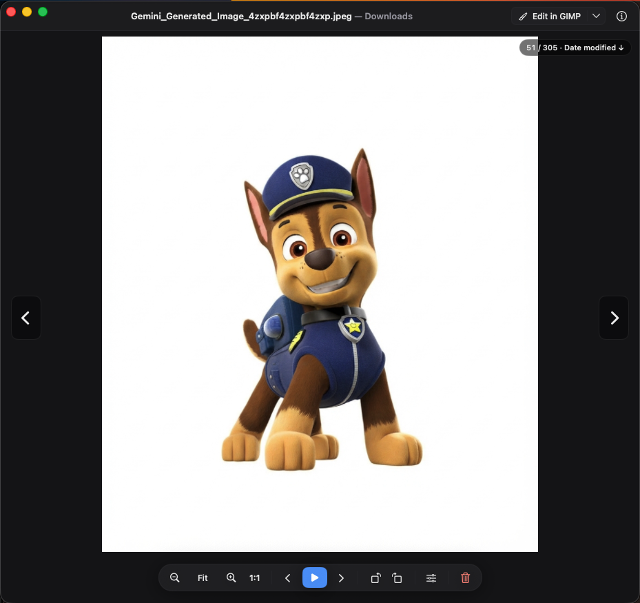
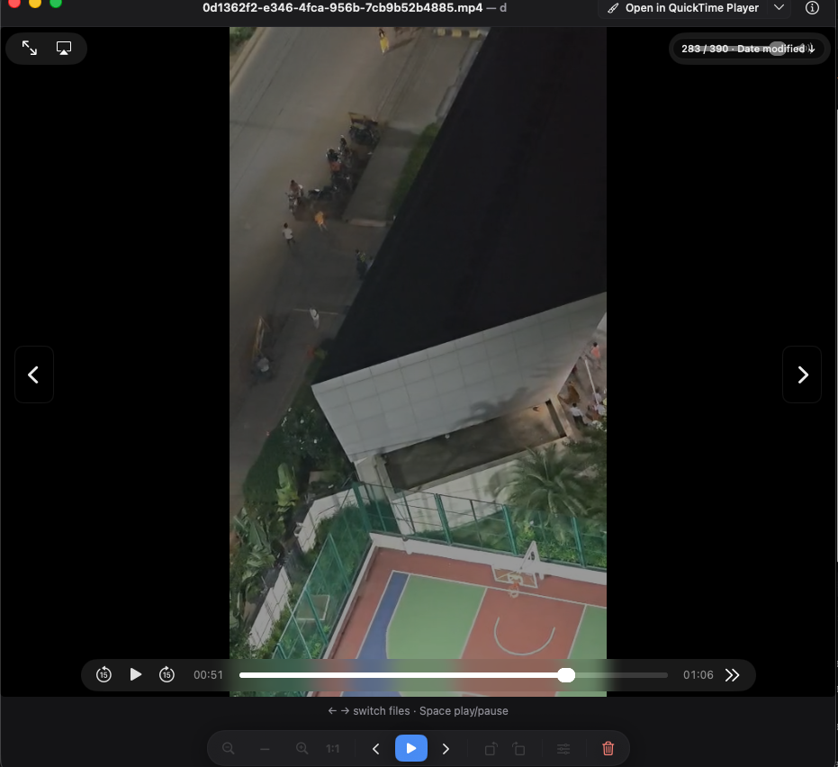

# Picsl

**A fast, simple image viewer for macOS.**

Open a picture and press ← / → to flip through every picture in that folder, newest first. There's no library to
import and no catalog to build: Picsl just shows the files in the folder you opened. It zooms, rotates, runs
slideshows and does quick edits, and it opens STL 3D models and videos too.

If you've used Windows Photo Viewer, you'll feel right at home.

<p align="center">
  
  
  
</p>

Picsl is written in Swift with AppKit and SwiftUI and uses only Apple's system frameworks (ImageIO, Core Image,
WebKit, ModelIO/SceneKit and AVKit). It has no third-party dependencies.

## Features

**Browsing**

- Open any supported file, then use ← / → to go through **every** supported file in that folder.
- Sorted by date modified (newest first) by default. Sort by date modified, date created, name, size or type,
  ascending or descending.
- Optional wrap-around at the end of the folder.
- Choose which file types are shown; all are on by default.

**Viewing**

- Zoom in and out, actual size and zoom to fit. Scroll-wheel and trackpad zoom (or switch scrolling to pan and
  zoom with ⌘/⌥ + scroll).
- Rotate left and right.
- Slideshow with a configurable interval.
- Full screen.
- Info panel: kind, dimensions, file size, camera, date taken, modified and created dates, location in Finder.
- Move to Trash straight from the viewer.

**More than photos**

- **SVG** vector graphics.
- **STL** 3D models shown as an orbitable model: drag to orbit, scroll to zoom, Shift-drag to pan.
- **Video** playback (MP4, MOV, M4V) inline, with Space for play/pause.

**Editing (non-destructive)**

- Light: exposure, brightness, contrast, highlights, shadows.
- Color: saturation, vibrance, warmth, tint.
- Detail: sharpness.
- Crop & rotate: crop with free, original, 1:1, 4:3, 3:2 and 16:9 aspect presets (landscape or portrait),
  rotate, flip horizontal/vertical, straighten.
- Hold `\` (or press Compare) to see the unedited picture.
- On the first save, the untouched file is kept in an `original/` subfolder next to the picture. Picsl never
  overwrites a file of your own that is already in `original/`.
- **Revert to Original** restores the backed-up file at any time.
- Formats that macOS cannot write back (RAW, PSD) are saved as a JPEG (or PNG, if the picture has
  transparency) in the same folder, and the source file is moved to `original/`.

**Integration**

- **Edit in** your favourite external editor (GIMP, Photoshop, Pixelmator, Affinity, ...), picked from the apps
  installed on your Mac. ⌘E opens the current file in your primary editor.
- **Open With** any other app that can open the file.
- **Make default viewer**: one click in Settings makes Picsl the default app for the checked file types. macOS
  may ask you to confirm each type.

## Supported formats

| Kind   | Formats |
| ------ | ------- |
| Images | JPEG, PNG, HEIC/HEIF, GIF, WebP, TIFF, BMP, AVIF, JPEG XL, PSD, ICO |
| RAW    | DNG, CR2, CR3, NEF, NRW, ARW, ORF, RW2, RAF, SRW, PEF, RWL, 3FR, ERF, KDC, MRW, X3F |
| Vector | SVG |
| 3D     | STL |
| Video  | MP4, MOV, M4V |

Image decoding is done by macOS, so format support (for example AVIF, JPEG XL and individual RAW cameras)
depends on your macOS version.

## Requirements

- macOS 14 Sonoma or later
- Apple silicon or Intel Mac

## Install

### Homebrew (recommended)

```sh
brew install --cask SriharshaShesham/tap/picsl
```

The cask removes the macOS quarantine flag after installing, so Picsl opens straight away.

### Manual download

1. Download `Picsl-<version>.zip` from the [Releases](https://github.com/SriharshaShesham/Picsl/releases) page.
2. Unzip it and drag **Picsl.app** to your Applications folder.

Picsl is free and is not notarized by Apple, so on first launch macOS says it "could not verify" the app. To
open it, either:

- go to **System Settings → Privacy & Security**, scroll down and click **Open Anyway**, or
- run this in Terminal:

  ```sh
  xattr -dr com.apple.quarantine /Applications/Picsl.app
  ```

You only need to do this once.

## Keyboard shortcuts

| Action | Shortcut |
| ------ | -------- |
| Previous / next file | ← / →, Page Up / Page Down |
| First / last file | Home / End |
| Next image | Space (play/pause for videos) |
| Zoom in / out | ⌘+ (or ⌘=) / ⌘− |
| Actual size | ⌘0 |
| Zoom to fit | ⌘9 |
| Rotate left / right | ⌘L / ⌘R |
| Slideshow | F5 or ⌘⇧S (Esc to stop) |
| Show info | ⌘I |
| Full screen | ⌃⌘F (Esc to leave) |
| Move to Trash | Delete or ⌘⌫ |
| Show in Finder | ⌘⇧R |
| Edit in external editor | ⌘E |
| Open file | ⌘O |
| Settings | ⌘, |

**While editing**

| Action | Shortcut |
| ------ | -------- |
| Start editing | E or ⌘⇧E |
| Save edits | ⌘S |
| Cancel editing (or cancel the crop) | Esc |
| Apply crop | Return |
| Compare with the original | hold `\` |
| Rotate left / right | ⌘L / ⌘R |

## Build from source

Picsl builds with the Xcode **Command Line Tools** alone; no Xcode project or Swift package is needed.

```sh
xcode-select --install   # if the Command Line Tools are not installed yet

./build.sh               # debug build -> build/Picsl.app
./build.sh run [file]    # build, then open the app (optionally with a file)
./build.sh release       # optimized universal build (Apple silicon + Intel)
./build.sh dist          # release build packaged as a zip for distribution
./build.sh typecheck     # fast type-check only
```

The first build compiles the system module cache and can take a couple of minutes; later builds are much faster.

## License

[MIT](LICENSE) © 2026 Sriharsha Shesham

Picsl is an independent project and is not affiliated with or endorsed by Microsoft. Windows is a trademark of
Microsoft Corporation.
